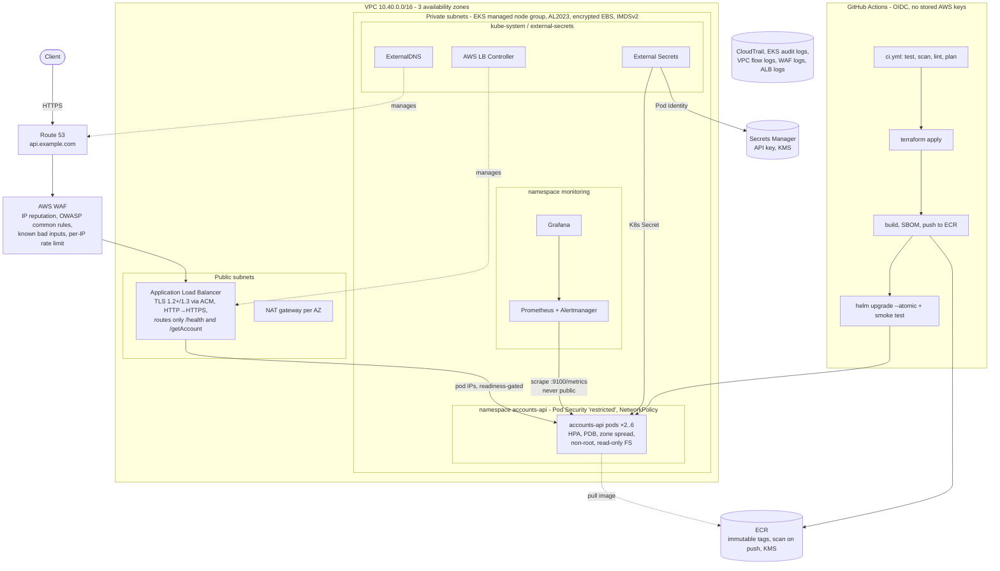

# Solution: Accounts API on Amazon EKS

This document is the submission write-up for the Mono Senior DevOps assessment. It covers architecture,
how to run and tear down, decisions and trade-offs, security and compliance, backup and recovery, and the
gaps that remain. A step-by-step account of *how* each problem was found and fixed, with the evidence,
is in [docs/WALKTHROUGH.md](docs/WALKTHROUGH.md).

## What is in the repository

| Path | What it is | Brief item |
|---|---|---|
| `src/`, `test/` | The service, hardened (graceful shutdown, bounded metrics, latency histogram, API key, readiness) plus 15 tests | Updated service |
| `Dockerfile` | Multi-stage build, distroless non-root runtime | 1 |
| `infra/terraform/bootstrap/` | One-time stack: remote state, GitHub OIDC, CI roles, CloudTrail | 2, 5, 6 |
| `infra/terraform/platform/` | VPC, EKS, ECR, WAF, KMS, Secrets Manager, cluster add-ons, RBAC | 2, 3, 6 |
| `deploy/helm/accounts-api/` | Helm chart: Deployment, Service, Ingress (ALB), HPA, PDB, NetworkPolicy, ServiceMonitor, alerts, ExternalSecret | 4, 6 |
| `.github/workflows/` | `ci.yml` (PR checks + plan), `deploy.yml` (push to main → prod), `destroy.yml` | 5 |
| `observability/` | kube-prometheus-stack values and the Grafana dashboard JSON | Bonus 1, 3 |
| `docs/eks-upgrade-runbook.md` | Zero-downtime EKS upgrade plan | Bonus 2 |
| `scripts/kind-up.sh` | Whole stack on a local three-zone kind cluster, no AWS account needed | Verification |

## Architecture



**Request path.** DNS points at the ALB. WAF inspects every request before it reaches the ALB listener:
known-bad IPs, OWASP-style payloads and clients over 1,000 requests per 5 minutes are blocked. The ALB
terminates TLS with an ACM certificate (TLS 1.3 policy, HTTP redirected), and only `/health` and
`/getAccount` have routing rules; everything else, including `/metrics`, gets the ALB's 404. Traffic goes
straight to pod IPs in private subnets. `/getAccount` additionally requires an `x-api-key` header whose
value lives in Secrets Manager.

**Availability.** Three AZs, a NAT gateway per AZ, at least two pods spread across zones and nodes, a
PodDisruptionBudget, `maxUnavailable: 0` rollouts, ALB readiness gates, and graceful drain on SIGTERM. The
API keeps serving through a pod crash, a node loss, an AZ loss, a rolling deploy and an EKS node upgrade.
The deploy and node-drain behavior is demonstrated in the walkthrough (zero failed requests).

**Delivery path.** A push to `main` runs CI, then `terraform apply` (infrastructure is reconciled on every
deploy), then builds and pushes an image tagged with the commit SHA, then `helm upgrade --atomic`, which
rolls back on its own if the new pods do not become ready, then a smoke test through the public URL.
Every job that touches AWS runs in the protected `production` GitHub environment.

## How to run it

### Locally, no AWS (about 10 minutes)

```bash
npm ci && npm test                 # 15 tests (the SIGTERM test runs on Linux/macOS)
npm run dev                        # API on :3000, metrics on :9100
docker build -t accounts-api:local .
scripts/kind-up.sh                 # app + Prometheus + Grafana + dashboard on a 3-zone kind cluster
scripts/kind-down.sh
```

### On AWS, from scratch

Prerequisites: an AWS account with admin access for the one-time bootstrap, Terraform ≥ 1.11, the AWS
CLI, `gh`, and a fork of this repository. Optionally a Route 53 hosted zone for TLS and a real hostname.

1. **Bootstrap (once, from a laptop, with admin credentials):**
   ```bash
   cd infra/terraform/bootstrap
   terraform init
   terraform apply -var github_repository=<you>/devops-assessment
   terraform output -raw github_variables | bash     # sets the repo variables with gh
   ```
   This creates the state bucket, the GitHub OIDC provider, the `plan`/`apply`/`deploy` roles and CloudTrail.
2. **Create the `production` environment** in the GitHub repository settings. Add required reviewers
   and limit deployment branches to `main`. The apply and deploy roles trust *only* jobs in this environment.
3. **Configure the platform:** set `github_repository` in `infra/terraform/platform/env/demo.tfvars`
   (and `domain_name`/`hosted_zone_id` for HTTPS). Optionally set the repository variable
   `TF_VAR_FILE=env/production.tfvars` for the full-HA profile.
4. **Push to `main`.** `deploy.yml` creates everything (about 25 minutes the first time, mostly EKS) and
   prints the URL in the job summary. Get the API key with:
   ```bash
   aws secretsmanager get-secret-value --secret-id accounts-api/api-key --query SecretString --output text
   curl -H "x-api-key: <key>" https://<host>/getAccount
   ```
5. **Grafana:** `aws eks update-kubeconfig --name accounts-api`, then
   `kubectl -n monitoring port-forward svc/kube-prometheus-stack-grafana 3000:80` and open the *Accounts API* dashboard.
   To use kubectl as a human, add your role ARN to `admin_principal_arns`.

Every later change ships the same way: PR (tests, scans, plan) → merge → approve the environment → deployed.

### Tear down

Run the **destroy** workflow (type `accounts-api` to confirm). It uninstalls the app first, so the
controller deletes the ALB, then runs `terraform destroy`. The bootstrap stack is left in place on
purpose (state history and audit trail); remove it with `terraform destroy` in `infra/terraform/bootstrap`
after emptying the buckets, if wanted.

**Cost while running:** the demo profile is about $0.45/hour (EKS control plane $0.10, 2 × t3.large, one
NAT gateway, ALB, WAF). The production profile is about $0.80/hour (three NAT gateways, VPC endpoints,
three nodes). Destroy the stack when you are not using it.

## Decisions and trade-offs

| Decision | Chosen | Rejected | Why |
|---|---|---|---|
| Building the image "with the same Terraform file" | Terraform owns the ECR repository and policies; CI builds and pushes the image | `null_resource` + `local-exec docker build` | Terraform models infrastructure state, not build artifacts. A `docker build` inside Terraform makes every plan depend on a Docker daemon, cannot be planned or diffed, and couples infra and app release cadence. CI still *uses* the Terraform stack: it applies it and reads its outputs (repo URL, WAF ARN, certificate) to build and deploy. |
| Deploying the app | Helm from CI, `--atomic` | `helm_release` in Terraform; Argo CD | The app changes many times a day; infrastructure rarely. Helm in CI gives automatic rollback and fast deploys without a full Terraform run. GitOps (Argo CD) is the next step, but it adds a controller and is more than this brief needs. |
| AWS auth from CI | GitHub OIDC, three roles with narrow trust (`pull_request` vs `environment:production`) | Access keys in GitHub secrets | No long-lived credentials to leak or rotate. Pull requests can only ever get read-only access. |
| Apply role permissions | PowerUserAccess + IAM limited to `accounts-api-*` names + deny attaching admin policies | AdministratorAccess | Terraform genuinely needs broad rights to build a VPC and cluster; scoping IAM by name prefix stops the pipeline from minting itself new privileges. Role names are outside the prefix so it cannot edit itself. A permissions boundary would close the remaining gap (see Gaps). |
| Workload AWS permissions | EKS Pod Identity, one role per add-on | IRSA; node instance role | Pod Identity needs no OIDC provider per cluster, and per-add-on roles mean the ALB controller cannot read secrets and External Secrets cannot touch load balancers. |
| Secret delivery | Secrets Manager → External Secrets → K8s Secret; value generated by an ephemeral resource and written through a write-only attribute | Value in Terraform state; value in Helm values; app calls Secrets Manager | The key never appears in state, plans, CI logs or the chart. The app stays cloud-agnostic (reads an env var). |
| Auth model | Shared API key on `/getAccount` | No auth; Cognito/JWT | The brief has no users or identity provider. A key is the smallest real control that makes account data non-public. OAuth2 client credentials (Cognito) is the production answer and is listed under Gaps. |
| Metrics exposure | Separate port 9100, not routed by the Ingress, NetworkPolicy allows only the monitoring namespace | `/metrics` on the public port; blocking it with a WAF rule | Removing it from the public listener removes the attack surface instead of filtering it. Three layers (port, Ingress, NetworkPolicy) each stop it on their own. |
| Container base | Distroless Node 22 (Debian 13), non-root | `node:22-alpine`; `node:22-slim` | No shell or package manager in the runtime image. Debian 13 was chosen over Debian 12 because the Debian 12 distroless image carried a critical OpenSSL CVE with a fix available (see walkthrough). |
| Graceful shutdown | App handles SIGTERM itself; preStop sleep; readiness fails on SIGTERM | `tini`/`dumb-init` | An init shim forwards signals but does not drain connections. The app needs drain logic anyway, and handling SIGTERM makes PID 1 behave correctly. |
| Observability | kube-prometheus-stack in-cluster | Amazon Managed Prometheus + Managed Grafana | Self-contained, free, and testable on kind. AMP/AMG is the better operational choice for production (durable, no storage to manage) and is listed under Gaps. |
| Region | eu-west-1 | af-south-1 (Cape Town) | af-south-1 is closer to Lagos, but it is opt-in. eu-west-1 has every service used here and is the common choice for West African fintechs. Data-residency requirements under Nigeria's NDPA may change this. |
| Cost profile | `env/demo.tfvars` (single NAT, no interface endpoints, 2 nodes) | Always full HA | Same architecture, much cheaper to keep up for review. `env/production.tfvars` switches on full redundancy. |

## Security and compliance

### Least-privilege IAM

| Principal | Can do | Cannot do |
|---|---|---|
| `github-accounts-api-plan` (PRs) | Read AWS (ReadOnlyAccess), read state, write the lock file | Change anything; read secret values; reach the cluster |
| `github-accounts-api-apply` (production env) | Manage infrastructure; IAM only on `accounts-api-*` | Attach AdministratorAccess, IAMFullAccess or PowerUserAccess; edit its own role |
| `github-accounts-api-deploy` (production env) | Push to the `accounts-api` ECR repo; `DescribeCluster`; K8s RBAC in namespace `accounts-api` only | Touch Terraform state, other repos, other namespaces, cluster-scoped resources, RBAC |
| ALB controller, External Secrets, ExternalDNS pods | Own Pod Identity roles: ELB APIs / one secret + one KMS key / one hosted zone | Anything else; node credentials (IMDS hop limit 1) |
| App pods | Nothing: no AWS role, `automountServiceAccountToken: false` | Call the Kubernetes or AWS APIs |
| Humans | Cluster admin only if listed in `admin_principal_arns` (EKS access entries) | Implicit admin from creating the cluster (disabled) |

### Secrets

No long-lived credentials exist anywhere: CI uses OIDC, pods use Pod Identity, the Kubernetes API uses
short-lived IAM tokens. The one application secret, the API key, is generated by Terraform as an
*ephemeral* value and stored only in Secrets Manager (KMS-encrypted). It is never in Terraform state or
plan output, and it is redacted from WAF logs. External Secrets syncs it hourly into a Kubernetes Secret,
which EKS envelope-encrypts with a KMS key. Rotation: bump `api_key_version` and restart the Deployment.

### Encryption

| In transit | At rest |
|---|---|
| Client → ALB: TLS 1.2/1.3 only (`ELBSecurityPolicy-TLS13-1-2-2021-06`), HTTP redirected, HSTS | Kubernetes Secrets: KMS envelope encryption (customer-managed key, rotation on) |
| AWS APIs (ECR, STS, Secrets Manager): TLS, via VPC endpoints in the production profile | EBS node volumes: encrypted gp3 |
| State, CloudTrail and log buckets: policies deny non-TLS access | ECR images and Secrets Manager: customer-managed KMS key |
| Gap: ALB → pod hop is HTTP inside the VPC (see Gaps) | Terraform state: SSE-KMS; CloudTrail: SSE-KMS; ALB logs: SSE-S3 (AWS limitation) |

### Audit logging

| Log | What it answers | Retention |
|---|---|---|
| CloudTrail (multi-region, log file validation, KMS) | Who changed what in AWS | 365 days (Glacier IR after 90) |
| EKS control-plane logs incl. `audit` and `authenticator` | Who did what in Kubernetes | 90 days (CloudWatch) |
| VPC flow logs | Which IPs talked to which | 90 days |
| WAF logs (API key redacted) | Which requests were blocked and why | 90 days |
| ALB access logs | Every request at the edge | 90 days (S3) |
| App JSON access logs (method, route, status, latency, client IP, X-Amzn-Trace-Id) | What the app served, correlated with ALB logs | 90 days: CloudWatch Observability add-on (Fluent Bit) → `/aws/containerinsights/accounts-api/application` |
| GitHub Actions run history + environment approvals | Who deployed which commit, who approved it | GitHub retention |

### Supply chain and workload hardening

Actions pinned to commit SHAs (Dependabot keeps them current) · `npm ci --ignore-scripts` · `npm audit` gate ·
Trivy image scan (HIGH/CRITICAL fixable = fail) and IaC scan, with accepted findings justified in
`.trivyignore` · ECR scan on push · immutable image tags · SBOM and SLSA provenance attestations attached to
every pushed image · Pod Security `restricted` enforced on the namespace · non-root, read-only root filesystem,
all capabilities dropped, seccomp `RuntimeDefault` · default-deny NetworkPolicy (the app's only egress is DNS).

### Control evidence

This service holds bank account numbers, not payment card numbers, so PCI DSS does not apply to it
directly. The mapping below shows which requirements the setup would provide evidence for if it sat inside a
cardholder data environment, alongside ISO/IEC 27001:2022 Annex A.

| Area | Implementation (evidence) | ISO 27001:2022 Annex A | PCI DSS v4.0.1 |
|---|---|---|---|
| Network segmentation | Private subnets, NetworkPolicy, SGs managed per ALB, default SG stripped | 8.20, 8.22 | 1.2, 1.3, 1.4 |
| Secure configuration | Everything in Terraform/Helm, PR review, Pod Security `restricted`, IaC scanning | 8.9 | 2.2 |
| Protecting stored data | KMS-encrypted secrets, EBS, ECR, state | 8.24 | 3.5, 3.6 |
| Encryption in transit | TLS 1.2+ at ALB, HSTS, TLS-only bucket policies | 8.24 | 4.2.1 |
| Vulnerability management | Trivy, ECR scanning, npm audit, Dependabot | 8.8 | 6.3.1, 6.3.3, 11.3.1 |
| Public-facing app protection | AWS WAF managed rules + rate limiting in front of the ALB | 8.20, 8.23 | 6.4.2 |
| Secure SDLC and change control | PR checks, plan on PR, environment approval, `--atomic` rollback, git history | 8.25, 8.28, 8.29, 8.32 | 6.2, 6.5.1 |
| Separation of environments | Plan role only for PRs; prod jobs gated by environment; tfvars per environment | 8.31 | 6.5.3 |
| Least privilege and access control | Roles in the table above, EKS access entries, namespace RBAC | 5.15, 5.18, 8.2, 8.3 | 7.2.1, 7.2.2 |
| Authentication | OIDC/STS short-lived credentials, no shared IAM users, API key on account data | 5.17, 8.5 | 8.2, 8.3, 8.6 |
| Logging and monitoring | CloudTrail, EKS audit, flow/WAF/ALB logs, Prometheus alerts | 8.15, 8.16 | 10.2, 10.3, 10.5.1, 10.7 |
| Capacity and availability | Multi-AZ, HPA, PDB, SLO alerts | 8.6, 8.14, 5.30 | 12.10.1 (supports) |
| Backup | Versioned state, images in ECR, everything rebuildable from code | 8.13 | 12.10.1 (supports) |

Nigeria's Data Protection Act 2023 (NDPA) also applies to customer names and account numbers. It is met by
the same access-control, encryption and logging controls, plus a data-residency decision on the region.

## Backup and recovery

The service is **stateless**: its data is compiled into the image, and everything else (infrastructure,
cluster config, dashboards, alerts) is code in git. Recovery means redeploying, not restoring.

| Failure | Recovery | RTO | RPO |
|---|---|---|---|
| Pod crash | Liveness probe restart; the other replica keeps serving | 0 (no user impact) | 0 |
| Node loss | Pods rescheduled; managed node group replaces the node | 0 (≥ 2 replicas on different nodes) | 0 |
| AZ loss | Remaining AZs keep serving; the ALB stops routing to the failed AZ | ~1 minute (ALB health checks) | 0 |
| Bad release | `helm --atomic` auto-rollback, or `helm rollback`, or redeploy any previous SHA from ECR | < 5 minutes | 0 |
| Cluster or region loss / accidental destroy | Re-run `deploy.yml` (Terraform recreates VPC + EKS; image is in ECR) | ~45 minutes (EKS creation dominates) | 0 for the app; last apply for infra state |
| Terraform state corruption | Restore a previous object version (bucket is versioned, 90 days) | < 15 minutes | Last apply |

**Suggested targets:** RTO 1 hour and RPO 0 for a full-region rebuild; RTO under 5 minutes for anything
short of losing the region. To meet the region case faster: ECR cross-region replication, a second
`production-dr.tfvars` stack in another region kept warm or pilot-light, and Route 53 failover records.
Once real data exists (for example RDS for accounts), RPO becomes a data problem: RDS Multi-AZ, automated
backups with point-in-time recovery (RPO about 5 minutes), cross-region snapshot copy, and a quarterly restore drill.

## Gaps before this is production-ready

| Gap | Risk | Plan |
|---|---|---|
| Not yet applied to a live AWS account in this submission | Unexercised IAM or quota edge cases | Run the pipeline in a sandbox account; everything else is validated (see walkthrough, "What was not verified") |
| API key auth, single shared key | No per-client identity or revocation | OAuth2 client credentials via Amazon Cognito or the bank's IdP, verified at the ALB (`authenticate-oidc`) or API Gateway; per-client rate limits |
| ALB → pod traffic is plaintext inside the VPC | Weaker than end-to-end TLS (PCI expects encryption on untrusted networks only, but fintech policy often wants it everywhere) | Backend TLS with a cert-manager issued certificate, or a service mesh with mTLS |
| Public EKS API endpoint (IAM-authenticated) | Larger attack surface on the control plane | Self-hosted runners in the VPC, then private-only endpoint |
| Apply role still broad (PowerUser + prefixed IAM) | A compromised pipeline could create costly or exposed resources | IAM permissions boundary required on created roles, SCPs at the organization level, AWS Config rules |
| Prometheus storage is ephemeral, single replica | Metrics lost on pod restart; no long-term retention | Amazon Managed Prometheus (remote-write) + Managed Grafana with SSO |
| Alertmanager has no receivers | Alerts fire but nobody is paged | Route to PagerDuty/Opsgenie/Slack; add a runbook URL to each alert |
| No staging environment | Changes reach production after CI only | A `staging.tfvars` stack and a promotion step (same image SHA) |
| No load or chaos testing in CI | Capacity limits unknown | k6 load test against staging, AWS FIS AZ-failure experiment |
| Logs go to CloudWatch only | No central SIEM correlation | Ship CloudTrail/EKS/WAF logs to Security Lake or the bank's SIEM; GuardDuty EKS protection |
| Secret rotation needs a restart | Rotated key not picked up until rollout | Reloader (restart on Secret change) or read the key from a mounted file and watch it |
| Image signing | Provenance is attached but not enforced at admission | Sign with cosign/AWS Signer; enforce with Kyverno or Gatekeeper |

## How AI was used

This solution was built with **Claude Code (Anthropic)** acting as a pair engineer, under my direction and review:

- **Review of the starter repo:** the assistant built and ran the original code, probed every endpoint, and
  produced the findings list (unbounded metric labels, ignored SIGTERM, duplicate IDs, public `/metrics`,
  leaked error messages, broken `npm run dev`, vulnerable dependencies). Each finding was reproduced before it was fixed.
- **Implementation:** code, Terraform, Helm chart, workflows and docs were drafted by the assistant and
  checked by running them: unit tests on Windows and Linux, Docker build and run, `terraform validate`
  against the real module versions, `helm lint` + kubeconform, actionlint, Trivy, and a full deploy on kind
  with a zero-downtime drill.
- **Where the tooling caught the AI:** module input names were checked against the downloaded module
  source rather than trusted from memory. That caught a silently dropped attribute (`cluster_arn` vs
  `cluster_name` on Pod Identity associations) and IAM policy names that would have fallen outside the CI
  role's permitted prefix. The kind deploy caught a Helm type error, and Trivy caught a critical OpenSSL CVE in
  the first base image. These are described in the walkthrough.
- **Decisions** (trade-offs above, scope, what to leave as gaps) were reviewed and owned by me.
