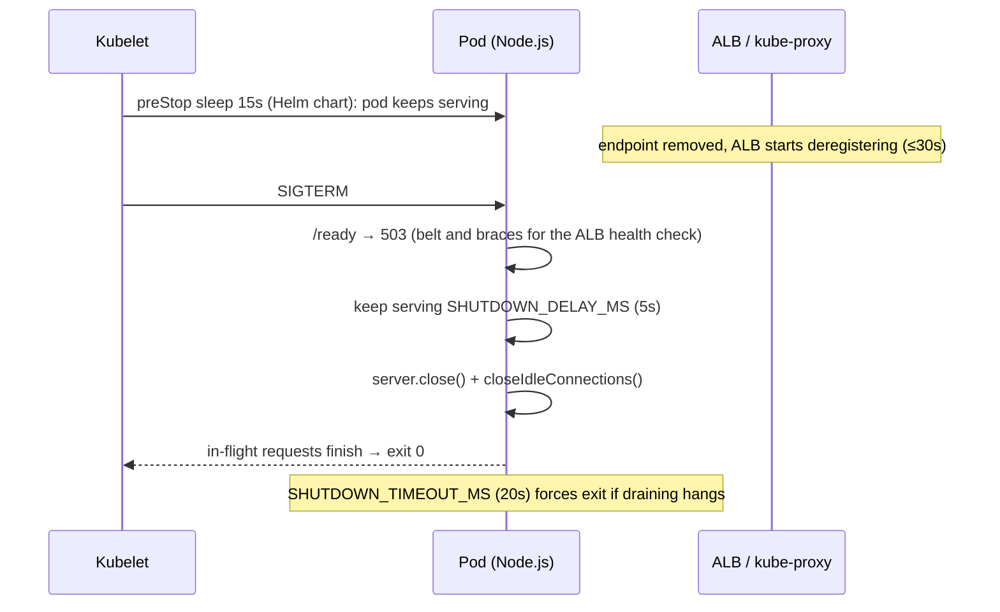
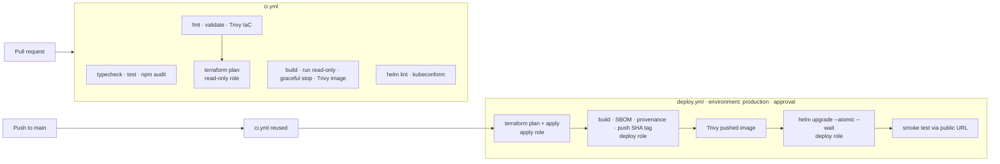

# Guided walkthrough: from starter repo to a production-shaped EKS deployment

This is the story of how the solution was built: what was found, what was decided, what was done, and
how each step was proven. It follows the order the work happened in, so it can be read top to bottom
as a narrative or used as a checklist to reproduce everything.

Each step uses the same shape:

> **Problem** → **What I did** → **Why** → **Proof** (commands you can run, and what they showed)

The focus is DevOps (delivery, infrastructure, reliability, security, observability). The application
changes are covered where they exist to serve those goals.

**Contents**

0. [Read the brief and plan](#step-0--read-the-brief-and-plan)
1. [Baseline the starter app](#step-1--baseline-the-starter-app)
2. [Make the service operable](#step-2--make-the-service-operable)
3. [Containerize it](#step-3--containerize-it)
4. [Terraform foundations: the bootstrap stack](#step-4--terraform-foundations-the-bootstrap-stack)
5. [Terraform platform: VPC, EKS, ECR, edge security](#step-5--terraform-platform-vpc-eks-ecr-edge-security)
6. [Package for Kubernetes: the Helm chart](#step-6--package-for-kubernetes-the-helm-chart)
7. [CI/CD with GitHub Actions](#step-7--cicd-with-github-actions)
8. [Observability: metrics, dashboard, alerts, logs](#step-8--observability-metrics-dashboard-alerts-logs)
9. [Prove it locally](#step-9--prove-it-locally)
10. [What was verified, and what was not](#step-10--what-was-verified-and-what-was-not)
11. [Issue tracker: every problem and where it was fixed](#step-11--issue-tracker)

---

## Step 0 · Read the brief and plan

**Problem.** The brief mixes required items, bonus items and documentation requirements, and two of its
sentences are ambiguous:

- *"Create a docker image and upload on AWS ECR using the same Terraform file"*
- *"a CI/CD script … that uses your Terraform file to create or update the docker image … and deploy"*

**What I did.** Mapped every requirement to a deliverable before writing anything:

| Brief item | Deliverable |
|---|---|
| 1 Dockerfile | `Dockerfile`, `.dockerignore` |
| 2 EKS with Terraform | `infra/terraform/platform` (VPC + EKS + add-ons) |
| 3 Image to ECR with Terraform | ECR repository in Terraform; image built and pushed by the pipeline that applies that Terraform |
| 4 Deploy from ECR to EKS | `deploy/helm/accounts-api` |
| 5 CI/CD on push to default branch | `.github/workflows/deploy.yml` (+ `ci.yml`, `destroy.yml`) |
| 6 Public, secure, available | ALB + WAF + ACM + multi-AZ + PDB/HPA + NetworkPolicy + IAM design |
| Bonus 1 Prometheus | kube-prometheus-stack + ServiceMonitor |
| Bonus 2 Upgrade plan | `docs/eks-upgrade-runbook.md` |
| Bonus 3 Dashboard JSON | `observability/dashboards/accounts-api.json` |
| Bonus 4 Live URL | Supported (`domain_name` + ExternalDNS + ACM); requires an AWS account |
| Submission doc | `SOLUTION.md` |

**Why.** For the ambiguous item, the defensible reading is: *Terraform owns the registry, the pipeline
owns the image, and the pipeline runs that Terraform.* A `docker build` inside Terraform (`null_resource`)
would make every plan depend on a Docker daemon, put build side effects outside state, and tie
infrastructure changes to application releases. The choice is recorded in SOLUTION.md, *Decisions and trade-offs*.

---

## Step 1 · Baseline the starter app

**Problem.** Before changing anything, know what you have. Reviewers plant flaws in starter code.

**What I did.** Built it, ran it, sent requests at every endpoint, and stopped it the way Kubernetes does.

```bash
npm ci --ignore-scripts && npm run build && PORT=3917 node dist/server.js &
curl localhost:3917/getAccount?id=1          # the README's own example
curl localhost:3917/random-a; curl localhost:3917/random-b
curl localhost:3917/metrics | grep http_requests_total
npm audit
```

**Proof: what it showed**

```text
GET /getAccount?id=1                         404  ids are 25-char hex strings; README example is wrong
GET /getAccount?id=66ab…911                  200  returns the FIRST record only: all three share one id
http_requests_total{…route="/random-a"…} 1        every unknown path creates a new time series
http_requests_total{…route="/random-b"…} 1
npm audit                                    2 low (cookie < 0.7.0 via routing-controllers 0.10.4)
```

Two more problems only appeared when the app was run the way the platform would run it:

```text
# In a container, `docker stop` (SIGTERM, like Kubernetes):
ORIGINAL: stop took 11s, exit=137        # SIGTERM ignored → killed after the timeout
# `npm run dev` (tsx):
TypeError: this.metrics.requestStarted is not a function   # every request crashes
```

The first is Node running as PID 1 with no signal handler: the kernel ignores SIGTERM for PID 1 unless a
handler is installed, so every rolling deploy would wait out the grace period and then SIGKILL in-flight
requests. The second is because `tsx` compiles with esbuild, which does not emit
`emitDecoratorMetadata`; TypeDI then has no constructor types and injects the container itself.

**The findings list** (the full table, with the fix for each, is in [Step 11](#step-11--issue-tracker)):

1. Metric label `route` is the raw path: unbounded cardinality, a memory DoS vector
2. No SIGTERM handling: dropped requests on every deploy and node drain
3. Unauthenticated endpoint returns names, account numbers and balances
4. No latency histogram (bonus 3 needs latency)
5. Duplicate account ids; README example wrong
6. `/metrics` on the public port
7. 500 responses leak `error.message`
8. One health endpoint (no readiness), no request logs
9. Vulnerable dependency (`cookie`), later more (`multer`, `body-parser`)
10. `npm run dev` crashes on every request

---

## Step 2 · Make the service operable

These are application changes, but each exists because the platform needs it.

### 2.1 Bounded metrics, latency histogram, in-flight gauge

**Problem.** `req.path` as a label means `GET /x1`, `/x2`, … each create a new series in the app's
memory and in Prometheus. Anyone on the internet can inflate both until something falls over.

**What I did.** `src/middleware/request-metrics.middleware.ts` labels by the *matched route template*
(`req.baseUrl + req.route.path`), or `unmatched` when no route matched. `src/services/metrics.service.ts`
adds `http_request_duration_seconds` (histogram, buckets 5 ms to 5 s) and `http_requests_in_flight`. The
middleware listens on `close` rather than `finish`, so aborted requests are counted too and the
in-flight gauge cannot leak.

**Proof.** Test `labels by route template so unknown paths cannot create new series` sends five random
paths and asserts no `route="/random-…"` label exists and `route="unmatched"` does.

### 2.2 Graceful shutdown and readiness

**Problem.** When Kubernetes stops a pod, two things happen at the same time: the pod gets SIGTERM, and
it is removed from Service endpoints and ALB target groups. The removal takes seconds to propagate, so a
pod that exits immediately drops requests the load balancer is still sending it.

**What I did.** `src/server.ts` and a new `GET /ready`:



Also: `server.keepAliveTimeout = 65s`. Node's default (5 s) is shorter than the ALB idle timeout (60 s),
which causes intermittent 502s when the ALB reuses a socket Node just closed.

**Proof.**

```text
FIXED:    docker stop → "stop took 6s, exit=0"   logs: shutdown started … shutdown complete
ORIGINAL: docker stop → "stop took 11s, exit=137"
```

Test `test/shutdown.test.mjs` (runs on Linux in CI) sends SIGTERM to the real server and asserts:
`/ready` returns 503, `/health` still returns 200 during the drain, and the process exits 0.

### 2.3 Metrics off the public port

**Problem.** `/metrics` exposes runtime internals and was on the same port as the public API.

**What I did.** `src/app.ts` now builds two apps: the public API (`PORT`, 3000) and a metrics app
(`METRICS_PORT`, 9100). The Ingress only routes port 3000, and only `/health` and `/getAccount`. The
NetworkPolicy only lets the `monitoring` namespace reach 9100. That is three independent layers, each
sufficient on its own.

**Proof.** Test `does not serve /metrics on the public port`, plus on kind (Step 9):
`:9100/metrics from default namespace → timeout (blocked)`; Prometheus scrape from `monitoring` → `up`.

### 2.4 Protecting account data

**Problem.** Names, account numbers and balances were public, and 500s returned raw error messages.

**What I did.**

- `src/middleware/api-key.middleware.ts`: when `API_KEY` is set, `/getAccount` needs a matching
  `x-api-key`. Both values are SHA-256 hashed before `timingSafeEqual`, so the comparison is constant-time
  and does not leak the key length. Probes stay unauthenticated.
- `src/middleware/error-handler.middleware.ts`: 4xx messages pass through (they are deliberate); 5xx
  return `Internal server error` and the details go to the log with the request's trace ID.
- `src/middleware/security-headers.middleware.ts`: HSTS, `nosniff`, `no-store`, CSP, frame denial;
  `x-powered-by` disabled.
- The key itself comes from AWS Secrets Manager (Step 5) and never appears in code, state or CI logs.

**Proof.** `test/auth.test.mjs` (no key → 401, wrong key → 401, right key → 200, probes open) and the
security-headers test.

### 2.5 Smaller fixes

- **Unique ids** (`src/services/account.service.ts`): now three distinct 24-character hex ids (the
  original's 25 characters was not a valid ObjectId either). README examples updated.
- **`npm run dev`**: `scripts/dev.mjs` runs `tsc --watch` with `node --watch dist/server.js`, so dev
  compiles exactly like production. `tsx` was removed.
- **Structured logs** (`src/logger.ts`): JSON lines with method, route, status, latency, client IP
  (`trust proxy` = 1 behind the ALB) and `X-Amzn-Trace-Id` to correlate with ALB logs. Probe traffic is
  not access-logged.

### 2.6 Dependencies

**Problem.** `npm audit` flagged `cookie`. The image scan in Step 3 found more: `body-parser` 1.20.8 and
ten `multer` 1.x CVEs, all pulled in by `routing-controllers` 0.10.

**What I did.** Upgraded `routing-controllers` to 0.11.3 (drops the vulnerable chain, adds the
`class-transformer`/`class-validator` peers) and `body-parser` to 1.20.9.

**Proof.** `npm audit` → `found 0 vulnerabilities`; all tests still pass after the major-version bump.

### 2.7 Tests

`npm test` builds and runs 15 integration tests (`node:test`, no extra dependencies) against the
compiled app: endpoints, auth, headers, metrics cardinality, histogram, and SIGTERM drain.

```text
# tests 15   # pass 15   # fail 0        (Linux, inside node:22 container)
```

---

## Step 3 · Containerize it

**Problem.** Brief item 1, done in a way that survives a security review and behaves on Kubernetes.

**What I did** (`Dockerfile`):

| Choice | Reason |
|---|---|
| Multi-stage: `node:22-trixie-slim` builds, then `npm prune --omit=dev` | Compiler and dev dependencies never reach the runtime image |
| `npm ci --ignore-scripts` | Reproducible from the lockfile; blocks install-time scripts (supply-chain attack vector) |
| Runtime `gcr.io/distroless/nodejs22-debian13:nonroot` | No shell, no package manager; UID 65532 |
| Files root-owned, process non-root | Works with `readOnlyRootFilesystem: true` |
| No `tini` | The app handles SIGTERM itself (Step 2.2), which is what actually drains connections |
| `.dockerignore` allow-list | Only `package*.json`, `tsconfig.json` and `src/` enter the build context |

**A finding along the way.** The first version used the Debian 12 distroless image. Trivy reported a
**critical OpenSSL CVE** (`CVE-2026-31789`, libssl3 3.0.18) plus five HIGH, all with fixes available, and
re-pulling the latest Debian 12 tag did not help. Scanning the alternatives:

```text
gcr.io/distroless/nodejs22-debian13:nonroot   fixable HIGH/CRIT: 0
gcr.io/distroless/nodejs24-debian13:nonroot   fixable HIGH/CRIT: 0
node:22-trixie-slim                           fixable HIGH/CRIT: 10   (npm's own bundled deps)
```

So the runtime moved to distroless Debian 13 and the build stage to `node:22-trixie-slim` (same glibc, so
native modules stay compatible). The build stage's findings never ship.

**Proof.**

```bash
docker build -t accounts-api:local .
trivy image --severity HIGH,CRITICAL --ignore-unfixed --exit-code 1 accounts-api:local   # exit 0
docker run -d --read-only --cap-drop ALL --security-opt no-new-privileges -p 3000:3000 accounts-api:local
curl localhost:3000/health                                                                # 200
docker stop -t 30 <id>                                                                    # 6s, exit 0
```

---

## Step 4 · Terraform foundations: the bootstrap stack

**Problem.** Remote state needs a bucket before any stack can use it, and CI needs AWS credentials
before it can run Terraform. Neither can be created by the pipeline that depends on it.

**What I did.** A small stack, `infra/terraform/bootstrap`, applied once by an admin:

| Resource | Security property |
|---|---|
| State bucket | Versioned (90-day history), SSE-KMS with its own key, public access blocked, TLS-only policy; S3-native locking (`use_lockfile`, no DynamoDB) |
| GitHub OIDC provider | CI gets 1-hour STS credentials; no AWS keys stored in GitHub |
| `github-accounts-api-plan` | Trusted only by `repo:<owner>/<repo>:pull_request`. ReadOnlyAccess + state read + lock file |
| `github-accounts-api-apply` | Trusted only by `…:environment:production`. PowerUserAccess + IAM restricted to `accounts-api-*` names + explicit deny on attaching Admin/IAMFull/PowerUser policies |
| `github-accounts-api-deploy` | Trusted only by `…:environment:production`. Push to one ECR repo + `eks:DescribeCluster` on one cluster |
| CloudTrail | Multi-region, log-file validation (tamper-evident), customer-managed KMS key, 365-day retention |

**Why the role names do not start with `accounts-api-`.** The apply role may manage IAM resources with
that prefix. If its own name matched, a compromised pipeline could attach new policies to itself. Keeping
the CI roles outside the prefix closes that path.

**Why `-refresh=false` for PR plans.** A full refresh would need the plan role to read the API key value
and the cluster's Secrets, and any branch in the repository can trigger a PR workflow. The PR plan is
therefore computed against state, and drift is caught by the full plan that runs right before apply.

**Proof.** `terraform validate` passes; the Trivy IaC scan initially flagged the CloudTrail bucket and
trail for not using a customer-managed key (`AVD-AWS-0015`, `AVD-AWS-0132`). Both were fixed by adding
`aws_kms_key.trail` with a key policy scoped to this trail's ARN.

---

## Step 5 · Terraform platform: VPC, EKS, ECR, edge security

**What I did** (`infra/terraform/platform`, community modules pinned: VPC 6.7, EKS 21.29, Pod Identity 2.10):

| File | What | Key decisions |
|---|---|---|
| `vpc.tf` | VPC over 3 AZs; /20 private subnets (VPC CNI gives pods VPC IPs), /24 public | NAT per AZ (toggle for demos); default SG stripped; flow logs; S3 gateway endpoint plus optional ECR/STS/logs/EC2 interface endpoints |
| `eks.tf` | EKS 1.35, managed node group (AL2023) | Explicit access entries (creator admin disabled); all control-plane log types incl. `audit`; KMS secrets encryption; VPC CNI with NetworkPolicy enforcement; IMDSv2 with hop limit 1; encrypted gp3; rolling node updates max 33% |
| `ecr.tf` | Repository | Immutable tags, scan on push, KMS, lifecycle (keep 50, expire untagged after 7 days) |
| `security.tf` | KMS key, Secrets Manager, WAF, ALB log bucket, ACM | API key generated by an **ephemeral** resource and written through a **write-only** attribute, so it never touches state; WAF: IP reputation, common rules, bad inputs, per-IP rate limit, logs with `x-api-key` redacted |
| `addons.tf` | ALB controller, metrics-server, External Secrets, kube-prometheus-stack, ExternalDNS, CloudWatch Observability | One Pod Identity role per add-on, each scoped to what it touches (one secret, one hosted zone…) |
| `k8s.tf` | App namespace, deployer RBAC, dashboard ConfigMap | Pod Security `restricted`; ALB readiness-gate injection; deploy role mapped to a namespace-scoped Role |
| `env/*.tfvars` | `demo` and `production` profiles | Same architecture; demo trades redundancy for cost |

**Two bugs caught by checking modules against their source rather than memory.** Terraform drops
unknown attributes in typed object variables *without an error*, so `terraform validate` passing proves
little. After `terraform init`, I checked every attribute I used against the downloaded module code:

1. Pod Identity `associations` take `cluster_name`, not `cluster_arn`. Mine would have been silently
   discarded, and the apply would have failed later with a confusing error.
2. The Pod Identity module names its IAM policies `AmazonEKS_*` by default. That is outside the
   `accounts-api-*` prefix the apply role may manage, so the first CI apply would have failed with
   AccessDenied. Fixed with `policy_name_prefix = "${var.name}-"`. I also confirmed that every other IAM
   name (cluster role, node role, encryption policy, flow-log role) falls under the prefix.

**IaC scan results and how each was resolved** (Trivy, HIGH/CRITICAL):

| Finding | Resolution |
|---|---|
| CloudTrail / trail bucket without CMK | **Fixed** (KMS key) |
| ALB log bucket without CMK | **Accepted**: ALB log delivery only supports SSE-S3 |
| EKS public endpoint, `0.0.0.0/0` | **Accepted** for GitHub-hosted runners (no fixed IPs); still IAM-authenticated and audit-logged. Gap: self-hosted runners and a private endpoint |
| Node SG allows all egress | **Accepted**: nodes need ECR/EKS/STS; pod egress is limited by NetworkPolicy instead |

Each accepted finding is in `.trivyignore` with its reason, so the CI gate stays strict for anything new.

---

## Step 6 · Package for Kubernetes: the Helm chart

**What I did** (`deploy/helm/accounts-api`). Every template maps to a requirement:

| Template | Availability | Security |
|---|---|---|
| `deployment.yaml` | ≥ 2 replicas, zone and node spread, `maxUnavailable: 0`, startup/liveness/readiness probes, preStop sleep | Non-root UID 65532, read-only root FS, drop ALL capabilities, seccomp, no service-account token |
| `pdb.yaml` | Drains can never take the last ready pod | |
| `hpa.yaml` | 2→6 pods at 70% CPU; slow scale-down | |
| `ingress.yaml` | ALB → pod IPs, health check on `/ready`, 30 s deregistration | TLS 1.3 policy, HTTP→HTTPS, WAF, access logs, drop invalid headers, only two paths routed |
| `networkpolicy.yaml` | | Default deny; HTTP from the VPC only; metrics from `monitoring` only; egress DNS only |
| `externalsecret.yaml` | | API key synced from Secrets Manager via the controller's Pod Identity |
| `servicemonitor.yaml`, `prometheusrule.yaml` | SLO alerts (5xx > 1%, p95 > 500 ms, target down) | |

Optional CRD-backed templates (`ServiceMonitor`, `PrometheusRule`) check `.Capabilities` so the chart
installs on clusters without the operator.

**Two chart bugs found by deploying it** (Step 9), not by linting:

1. `--set podAnnotations.rolloutId=$(date +%s)` produced a number; annotations must be strings, and the
   API server rejected the Deployment. Fixed with `--set-string`.
2. With an HPA, a Deployment must not set `replicas` (or every upgrade fights the autoscaler). But on
   *first* install that means 1 replica until the HPA reacts, which was about 10 s of no redundancy on kind.
   Fixed with a `lookup`: set `replicas: minReplicas` only when the Deployment does not exist yet.

**Proof.** `helm lint --strict` on both value files; `helm template` and **kubeconform** (strict, with CRD
schemas): `19 resources, Valid: 19, Invalid: 0`.

---

## Step 7 · CI/CD with GitHub Actions



**Design points**

- **No AWS keys anywhere.** Each job assumes a role over OIDC; the trust policy pins the repository *and*
  either `pull_request` or the `production` environment. The environment's required reviewers are the
  manual approval gate, and the roles cannot be used outside it.
- **Terraform runs on every deploy.** Infrastructure is reconciled continuously, and its outputs (ECR URL,
  WAF ARN, certificate, VPC CIDR) are passed to the build and deploy jobs as job outputs. The deploy role
  never touches state. (`mask-aws-account-id: false` is required, or GitHub silently drops outputs that
  contain the account ID.)
- **Immutable images.** Tag = commit SHA; the ECR repo rejects overwrites. A re-run of the same commit
  detects the existing image and skips the build instead of failing.
- **Safe rollouts.** `helm upgrade --atomic --wait` rolls back automatically if new pods do not become
  ready (which, with readiness gates, means healthy *in the ALB*). The smoke test then checks the public
  URL: `/health` 200, `/getAccount` 401 without a key and 200 with it, `/metrics` 404.
- **One deployment at a time**, never cancelled halfway (`concurrency`, `cancel-in-progress: false`).
- **Supply chain.** Every action pinned to a full commit SHA (resolved from each action's latest release;
  every input checked against that SHA's `action.yml`), Dependabot for actions, npm, Docker and Terraform.
  Images carry SBOM and SLSA provenance attestations.
- **Teardown has an order.** `destroy.yml` uninstalls the app first: the ALB belongs to the in-cluster
  controller, and destroying the VPC under it would hang on ENIs and security groups.

**Proof.** `actionlint` (with shellcheck) passes clean on all three workflows after fixing three
warnings it raised (unused loop variables, an unquoted expansion).

---

## Step 8 · Observability: metrics, dashboard, alerts, logs

```text
app :9100/metrics ──ServiceMonitor──▶ Prometheus ──▶ Grafana "Accounts API" dashboard
                                          └──▶ PrometheusRule SLO alerts ──▶ Alertmanager
app stdout (JSON) ──Fluent Bit (CloudWatch Observability add-on)──▶ CloudWatch Logs
```

- **Dashboard** (`observability/dashboards/accounts-api.json`, 15 panels in 5 rows): golden-signal stats (request
  rate, 5xx ratio, p95, availability over range), request rate by route and status, in-flight, error
  ratio 4xx vs 5xx, p50/p95/p99, p95 by route, CPU, memory, event-loop lag, ready vs desired pods,
  restarts. Variables for data source, namespace and service. Loaded automatically: Terraform puts the
  JSON in a ConfigMap labelled `grafana_dashboard: "1"`, which the Grafana sidecar watches.
- **Alerts**: error ratio > 1% for 5 min (critical), p95 > 500 ms for 10 min (warning), no healthy
  target for 5 min (critical).
- **Logs**: the CloudWatch Observability add-on (Pod Identity, log groups pre-created with retention).

**Proof.** Every panel query was executed against the kind cluster's Prometheus with the dashboard
variables substituted. All traffic, latency and saturation queries returned series. The first run found
that the *Error rate* and *Availability* stats returned **no series** when there were no errors, so
Grafana would show "No data" exactly when the service is healthy. Wrapping the error counts in
`or vector(0)` fixed it; they now read `0` and `1` (100%).

---

## Step 9 · Prove it locally

**Problem.** Linting proves syntax, not behavior. Without spending money on AWS, how do you show that the
chart deploys, the policies enforce, the metrics flow, and deploys and node upgrades cause no downtime?

**What I did.** `scripts/kind-up.sh` builds a three-node kind cluster, with nodes labelled as three
zones, and installs metrics-server, kube-prometheus-stack (same values file as EKS), the dashboard and
the app chart with `values-local.yaml`. Only the AWS-only pieces (ALB, WAF, Secrets Manager) are swapped out.

**Proof 1: behavior inside the cluster** (from a curl pod in the `default` namespace):

```text
GET /health                                      200
GET /getAccount (no key)                         401
GET /getAccount (wrong key)                      401
GET /getAccount (valid key)                      200
GET /metrics on public port                      404
GET :9100/metrics from default ns (NetPol)       000   ← blocked by NetworkPolicy
```

**Proof 2: monitoring chain** (Prometheus and Grafana APIs):

```text
targets:  serviceMonitor/accounts-api/accounts-api/0  accounts-api-…-8g2qd  up
          serviceMonitor/accounts-api/accounts-api/0  accounts-api-…-nphsw  up
requests: {route: /health, 200} {route: /ready, 200} {route: /getAccount, 401}
          {route: /getAccount, 200} {route: unmatched, 404}       ← bounded labels
rules:    accounts-api.slo [AccountsApiHighErrorRate, AccountsApiHighLatency, AccountsApiTargetDown]
grafana:  "Accounts API"  uid=accounts-api  /d/accounts-api/accounts-api
```

**Proof 3: the zero-downtime drill.** A load generator, pinned to the control-plane node so it is never
evicted, ran four concurrent loops of authenticated `GET /getAccount` against the Service, while:

1. a rolling update replaced both pods (`helm upgrade` with a new pod annotation), then
2. each of the three workers was drained in turn, which is exactly what an EKS managed node group
   upgrade does (`kubectl drain --ignore-daemonsets --delete-emptydir-data`, then uncordon).

```text
[19:02:30] load running
[19:02:30] phase 1: rolling update
[19:02:43] rollout done
[19:02:43] phase 2: drain every worker in turn (simulated EKS node upgrade)
[19:03:05]   drained accounts-api-worker
[19:03:27]   drained accounts-api-worker2
[19:03:51]   drained accounts-api-worker3
[19:04:06] results (HTTP status: count):
  25173 200
```

**25,173 requests, 25,173 × 200, zero errors**, through one rollout and three node drains. This is the
evidence behind the EKS upgrade plan ([eks-upgrade-runbook.md](eks-upgrade-runbook.md)): PDB + spread +
preStop + drain-aware shutdown keep the API serving while nodes are replaced.

---

## Step 10 · What was verified, and what was not

| Claim | Verified by | Status |
|---|---|---|
| App behavior, auth, headers, metrics, shutdown | 15 tests on Linux (14 on Windows, where the SIGTERM test is skipped) | Verified |
| Image builds, runs read-only, no fixable HIGH/CRITICAL CVEs | Docker + Trivy | Verified |
| Graceful stop (6 s, exit 0 vs 11 s, exit 137) | `docker stop` timing on both versions | Verified |
| Terraform is syntactically and structurally valid against real module/provider versions | `terraform validate` (TF 1.17, AWS provider 6.70, EKS module 21.29) + attribute check against module source | Verified |
| No unaccepted HIGH/CRITICAL IaC misconfigurations | Trivy config | Verified |
| Chart renders valid Kubernetes + CRD objects | helm lint, kubeconform | Verified |
| Chart deploys; NetworkPolicy, Pod Security, HPA, PDB, ServiceMonitor, alerts, dashboard all work | kind cluster | Verified |
| Zero-downtime rollouts and node drains | kind drill, 25,173/25,173 | Verified |
| Workflows are well-formed | actionlint + shellcheck | Verified |
| `terraform apply` on AWS, ALB/WAF/ACM behavior, Pod Identity wiring, External Secrets against Secrets Manager, pipeline end to end | Needs an AWS account | **Not verified** |

The unverified row is the honest boundary of this submission. The most likely failure points on a first
real apply, and what to check:

- **Account quotas** (EIPs for three NAT gateways, vCPU for t3.large): use the demo profile first.
- **The CloudWatch Observability add-on and its log groups**: if the agent creates a log group before
  Terraform does, import it (`terraform import`).
- **First pipeline run before the `production` environment exists**: the OIDC `sub` will not match and
  the role assumption fails, by design.

---

## Step 11 · Issue tracker

| # | Problem | Found by | Fix | Where |
|---|---|---|---|---|
| 1 | Unbounded `route` label | Probing `/metrics` | Route template / `unmatched` | `src/middleware/request-metrics.middleware.ts` |
| 2 | SIGTERM ignored | `docker stop` timing | Drain logic, readiness flip, keep-alive > ALB idle | `src/server.ts`, chart `lifecycle` |
| 3 | Account data public | Reading the controller | API key (Secrets Manager → ESO), WAF | `src/middleware/api-key.middleware.ts`, `security.tf`, `externalsecret.yaml` |
| 4 | No latency metric | Reading the brief | Histogram + in-flight gauge | `src/services/metrics.service.ts` |
| 5 | Duplicate ids, wrong README example | Probing `?id=` | Unique ids, README | `src/services/account.service.ts`, `README.md` |
| 6 | `/metrics` public | Reading `app.ts` | Separate port + Ingress paths + NetworkPolicy | `src/app.ts`, `ingress.yaml`, `networkpolicy.yaml` |
| 7 | 500s leak internals | Reading error handler | Generic 5xx, details logged | `src/middleware/error-handler.middleware.ts` |
| 8 | No readiness, no logs | Reading `health.controller.ts` | `/ready`, JSON access logs, log shipping | `health.controller.ts`, `src/logger.ts`, `eks.tf` |
| 9 | Vulnerable deps (`cookie`, `multer`, `body-parser`) | npm audit, Trivy | `routing-controllers` 0.11.3, `body-parser` 1.20.9 | `package.json` |
| 10 | `npm run dev` crashes | Running it | tsc + node watch | `scripts/dev.mjs` |
| 11 | Critical OpenSSL CVE in Debian 12 base | Trivy image | Distroless Debian 13 | `Dockerfile` |
| 12 | Pod Identity `cluster_arn` silently dropped | Checking module source | `cluster_name` | `addons.tf` |
| 13 | Add-on IAM policies outside CI prefix | Checking module source | `policy_name_prefix` | `addons.tf` |
| 14 | CloudTrail without CMK | Trivy IaC | KMS key with scoped policy | `bootstrap/cloudtrail.tf` |
| 15 | Numeric annotation rejected | kind deploy | `--set-string` | `scripts/kind-up.sh` |
| 16 | 1 replica on first install with HPA | kind deploy | `lookup`-based initial replicas | `deployment.yaml` |
| 17 | Container logs not shipped | Self-review of SOLUTION.md claims | CloudWatch Observability add-on | `eks.tf`, `addons.tf` |
| 18 | Error-rate and availability stats show "No data" when there are no errors | Running every dashboard query against live Prometheus | `or vector(0)` on error numerators | `observability/dashboards/accounts-api.json` |
| 19 | `deploy.yml` would be rejected at load time: called `ci.yml` requests `id-token: write` the caller did not grant | Manual review (actionlint does not catch it) | Grant it on the `checks` job | `.github/workflows/deploy.yml` |

## Reproduce everything

```bash
# App
npm ci && npm test && npm audit --omit=dev

# Image
docker build -t accounts-api:local .
docker run --rm -v /var/run/docker.sock:/var/run/docker.sock aquasec/trivy image --severity HIGH,CRITICAL --ignore-unfixed accounts-api:local

# Terraform (no AWS credentials needed)
for s in bootstrap platform; do terraform -chdir=infra/terraform/$s init -backend=false && terraform -chdir=infra/terraform/$s validate; done
docker run --rm -v "$PWD":/repo -w /repo aquasec/trivy config --severity HIGH,CRITICAL --ignorefile .trivyignore .

# Chart and workflows
helm lint deploy/helm/accounts-api --strict
docker run --rm -v "$PWD":/repo -w /repo rhysd/actionlint

# Whole stack locally, then tear down
scripts/kind-up.sh
scripts/kind-down.sh
```
